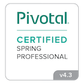

# Marc Koch

 _Software developer based in Munich, Germany_

[Email](mailto:info@marcko.ch) / [Twitter](https://twitter.com/marckoch1975) / [Xing](https://www.xing.com/profile/Marc_Koch35/cv) / [Linkedin](https://www.linkedin.com/in/marc-koch-159917209/) / [Project&nbsp;Euler](https://projecteuler.net/progress=marckoch75) / [codewars](https://www.codewars.com/users/marckoch) / [credly](https://www.credly.com/users/marc-koch/badges) / [Hackerrank](https://www.hackerrank.com/marckoch) / [github](https://github.com/marckoch) / [JetBrains&nbsp;Academy](https://hyperskill.org/profile/77202658) / [speakerdeck](https://speakerdeck.com/marckoch)

## strong knowledge in

Java SE, Java EE, Spring, SpringBoot, Software architecture, Clean architecture, Cloud native applications, 12 factor apps, Microservices, Software refactoring, Software quality, Software Security, OWASP, Clean Code, CI/CD, SQL, maven, git

## good knowledge in

Kubernetes, Docker, Javascript, Typescript, React, Angular, HTML, CSS, TDD, Design Patterns, Domain Driven Design, Openshift, arc42, terraform

## would love to do more of

Kotlin, Clojure, Functional programming, Security

## projects

|time|project|
|---|---|
| 11/2025 – 11/2026 | **senior backend developer / architect** part of a team digitalising medical service workflows for a German public sector (employment agency), including order management, electronic client records, document scanning, and billing.  • developed features and refined business and technical requirements. • provided architectural guidance and assessed implementation options and technical feasibility. • modernised legacy code, reduced technical debt, and improved application stability and performance. • implemented timeout and retry handling for a core external interface. • developed a new component for internal billing and automated test data generation. • improved integration test mocks and used Tabnine to support test creation and refactoring. • implemented public sector security requirements.  **technologies and methods:** Java 21, Jakarta EE 10, Oracle DB, REST, Swagger, TDD, arc42, ArchUnit, Scrum, Tabnine, AI |
| 04/2023 – 09/2025 | **senior backend developer / architect** developed an external customer platform for a German logistics company.  • built an internal access management application on Keycloak to manage external users, user groups, and access rights. • enabled internal administrators to manage access without working directly in Keycloak, while improving enforcement of business rules.  **technologies and methods:** Java 21, Spring Boot 4, Spring Cloud, Spring Security, OpenAPI, REST, OAuth2, OIDC, Keycloak, OpenShift, TDD, arc42, ArchUnit |
| 06/2022 – 03/2023 | **software developer / architect** developed Skillmatrix, an internal bbv application for tracking developers and their skills.  **technologies and methods:** Java 17, Spring Boot, Thymeleaf, HTML5, CSS, Bootstrap, Maven, Git, GitHub, SonarCloud, JUnit, PostgreSQL, Docker, AWS, Elastic Beanstalk, EC2, arc42, PlantUML, UML |
|12/2022 - 01/2023|**architectural consulting** in Swiss streaming plattform provider, analysis of backend code **technologies used**: Sonargraph|
|04/2021 - 06/2022|**software developer** at an insurance company setup automatic release process (mvn), introduction and coaching of git workflow, quality insurance by using SonarQube in the CI/CD pipeline, refactoring code to reduce SonarQube issues **technologies used**: Java 11, JUnit, OpenShift 4, Jenkins, SonarQube|
|10/2020 - 03/2021|**fullstack developer** at a telecommunications provider implementing user stories in frontend (React, Typescript) and backend (Java, Spring), reduction of technical debt, software modernization **technologies used**: Java 8, Spring, SpringBoot, JavaScript, Typescript, React, HTML, CSS, Redis, JUnit|
|02/2019 - 07/2020|**software developer / architect** at an insurance company modernization of a 17 year old software monolith, refactoring to microservices, analysis and documentation of current architecture, definition of new target architecture, reduction of technical debt, refactoring of build process from ant to maven, setup of new CI/CD build pipeline in Jenkins, refactoring of cycles in code, introduction of coding guidelines to the team **technologies used**: Java 8, Spring, mvn, ant, Jenkins, JUnit, ArchUnit, Sonargraph|
|11/2017 - 12/2018|**software developer** at an automotive company working in a backend application (microservice) in the ConnectedCar context, implementing user stories, code refactoring, increasing code quality, reduction of technical debt, bug fixing, update of documentation and coding guidelines **technologies used**: Java 8, JavaEE 7, Payara, JAX-WS, JAX-RS, JMS, JPA, Postgres DB, TDD, JUnit, mvn, Openshift 3, Jenkins|
|06/2017 - 08/2017|**fullstack developer** at an automotive company greenfield project of a new SPA based on Angular and Java EE, initial project setup, implementation of first use cases in prototype **technologies used**: Java 8, JavaEE 7, Glassfish, Angular, PrimeNG, bootstrap, Javascript, HTML, CSS, mvn|
|04/2017 - 05/2017|**software engineer** at an automotive company setup of ELK stack to monitor application logfiles spread over 26 servers, setup of initial visualizations in Kibana dashboard **technologies used**: Elasticsearch, Logstash, Kibana|
|08/2016 - 04/2017|**fullstack developer** at an automotive company new application for vehicle offerings, SPA with React and Play Framework using Java 8, implementing user storys, initial setup of CI/CD pipeline **technologies used**: Java 8, Play Framework, REST, Swagger, React, Javascript, Jenkins, Oracle DB, mvn|
|03/2016 - 08/2016|**backend developer** at an automotive company central application for receiving vehicle events, implement user storys, software changes and bug fixes, increase test coverage and code quality, reduce technical debt **technologies used:**: JavaSE, JaveEE, JPA, JMS, JAX-WS, JAX-RS, BEA Weblogic, Oracle, JUnit, mvn|
|07/2015 - 03/2016|**fullstack developer / project lead / technical lead** at an automotive company old legacy application (SWING + Corba, Java 1.3) had to be migrated to current architecture, analysis of current architecture (without documentation), definition of new target architecture (Java 7, Java EE 6, Glassfish application server), migrating application parts to verify new architecture, removal of old unused code parts, introduced automatic testing (JUnit) to safeguard migration process **technologies used**: Java 7, JavaEE 6, JUnit|
|2000 - 2015|lots of projects at an automotive company, mainly as **backend developer, lead developer, software architect**, also did operations, maintainance, testing, documentation, conceptual work **technologies used**: JavaSE, JaveEE, BEA Weblogic, Glassfish, SQL, PL/SQL, Oracle DB, JSF, Swing, C++|

## talks

|time|talk|
|---|---|
|05/2021|Online Webinar (in German): Microservices - blessing or curse? [recording](https://bbv-ch.zoom.us/rec/play/OJOthNgKvmkN7Hv4fMLCet_OM_NuaQ8VfWHzZnH9zqzcJw7sLFfyjqTSARFLu79-WhpAqevJxYmLYswH.o8ZvYyYipPGMZRKQ) / [slides](https://speakerdeck.com/marckoch/microservices-fluch-oder-segen)|
|06/2020|Beseitigen von Zyklen in einer Legacyanwendung (Refactoring of cycles in a legacy application)|

## certifications

_(click images to see badges)_

|time|achivement||
|---|---|---|
|coming soon|CSSLP - Certified Secure Software Lifecycle Professional|[iCS2](https://www.isc2.org/certifications/csslp)|
|11/2025|LFD121: Developing Secure Software|[LDF121](https://www.credly.com/badges/1f70f183-dc6e-4e71-a02f-2668e01ac333)|
|04/2023|Certified Kubernetes Application Developer|[CKAD](https://www.credly.com/badges/b1ae47ca-5a51-4744-8b6e-5174ee338e3f) (expired 04/2026)|
|11/2022|iSAQB CPSA-A Certified Professional Software Architect (Advanced)||
|08/2020|AWS Cloud Practitioner||
|07/2020|iSAQB CPSA-F Certified Professional Software Architect (Foundation)||
|07/2019|Oracle Certified Professional JavaSE 11 Developer (1Z0 817)||
|01/2019|Docker Certified Associate (expired 01/2021 and discontinued)||
|02/2018|Spring Core 4.3 Professional||
|older|Java 8 Associate (1Z0 808), Java 8 Professional (1Z0 809), Scrum Master, Elastic Search|

## other activity / nerd stuff

_(click images to see online profiles)_

## employments

|time|company|
|----|---|
|11/2017 - today|Senior Technical Consultant bbv Software Services GmbH, Munich|
|02/2002 - 09/2017|Software Developer JavaEE Sulzer GmbH, Munich|
|03/2000 - 01/2002|Software Developer C++ ELAXY, Puchheim|

## education

|time|place|
|---|---|
|1994 - 2000|University Kassel Physics Diploma|
|1988 - 1994|Goetheschule Kassel Abitur 1,4|
